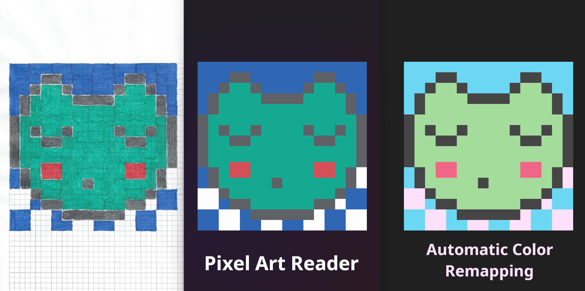
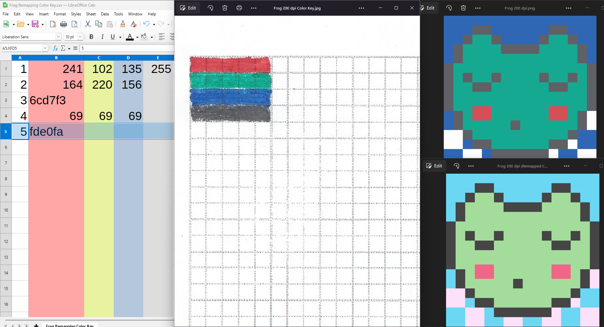
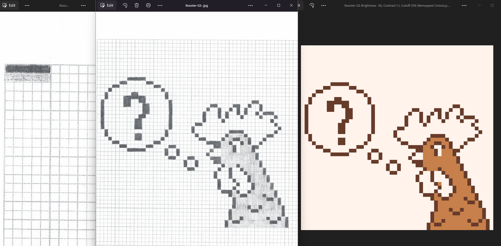

# PixelArtReader
PixelArtReader converts JPEG pixel art scans drawn on special graph paper into clean PNG pixel art images, complete with automatic color remapping!


<h3 align="center">PixelArtReader</h3>
<div align="center">
  
  [](https://github.com/LPBeaulieu/Handwriting-OCR-ScriptReader/blob/main/LICENSE)
  
  
  
</div>

---

<p align="left"> <b>PixelArtReader</b> is a tool enabling you to convert scanned JPEG pages of pixel art drawn on special graph grid pages into crisp pixel art PNG images! It also allows you to automatically remap the detected colors in your drawings to any colors of your choosing!<br>

My tests on about 3500 little squares within the 65x65 graph paper grid pages consistently gave me an <b>accuracy of around 99.8+%!</b>
<br> 
</p>

## 📝 Table of Contents
- [Dependencies / Limitations](#limitations)
- [Getting Started](#getting_started)
- [Usage](#usage)
- [Author](#author)
- [Acknowledgments](#acknowledgments)

## ⛓️ Dependencies / Limitations <a name = "limitations"></a>


## 🏁 Getting Started <a name = "getting_started"></a>

If your PC runs on Windows version 10 or later with a x86-64 architecture, then you will be able to run the compiled version of the Python scripts without need for installation of dependencies. Simply download the zipped folder in the release section and extract it in any destination of your choosing where you have writing permissions, such as the "Documents" folder. Then move on to the "Usage" section below for more on how to use the executable files within the working folder.

The following instructions will be provided in great detail, as they are intended for a broad audience and will
allow to run a copy of <b>PixelArtReader</b> on a local computer.

Start by holding the "Shift" key while right-clicking in your working folder, then select "Open PowerShell window here" to access the PowerShell in your working folder and enter the commands described below.

<b>Step 1</b>- Install <b>OpenCV</b> (Python library for image segmentation):
```
py -m pip install opencv-python
```

<b>Step 2</b>- Install <b>Pillow</b> (Python module for processing and generating PNG files):
```
py -m pip install Pillow
```

<b>Step 3</b>- Install <b>NumPy</b> (Python module for processing the pixel data within your JPEG scans):
```
py -m pip install numpy
```

<b>Step 6</b>- Create the "Scans" folder in your working folder, and the "Color Key" subfolder within the "Scans" folder:
```
mkdir "Scans" 
mkdir "Scans\Color Key" 
```

<b>Step 7</b>- You're now ready to use <b>PixelArtReader</b>! 🎉

## 🎈 Usage <a name="usage"></a>

**Getting Started:**

- PixelArtReader allows you to digitize your pixel art drawn on special 65x65 square graph paper sheets that allow the code to determine the location of every square cell in the grid. The code will then extract every square cell's pixel information, in order to predict which color they were drawn in relative to a color key that you will provide by following these steps: 

1- Select the option 2 from the PixelArtReader main menu ("Generate PDF Graph Paper Template With Current Settings") in order to generate your printable 65x65 grid PDF template. Print at least two copies of this PDF document, as you will need one for the color key, and one or more for your pixel art drawing (see the **Pixel Art Scale and Color Settings Menu** section below for more on pixel art drawings that span more than one 65x65 grid). Should you need to print the grid in A4 format or change any other layout settings, head over to the **Graph Paper Grid Layout Settings Menu** section down below for more details on this.

2- You will need to color in the five first squares of sequential rows in a blank 65x65 grid with each color of your pixel art drawing, excluding the white page color. For example, should you have used red, green, blue and black, you would fill the first five squares of the first four rows of the 65x65 grid as follows (please consult the CSV preparation image below for an example of this)
- Row 1: RRRRR (5 red squares, starting at the first square on the left)
- Row 2: GGGGG (5 green squares, starting at the first square on the left)
- Row 3: UUUUU (5 blue squares, starting at the first square on the left)
- Row 4: BBBBB (5 black squares, starting at the first square on the left)

3- Then, scan that page at the same resolution (200 dpi works well) as you will scan your pixel art drawing (drawn on separate 65x65 grids) and place the color JPG scan of your color key in the "Color Key" subfolder of the "Scans" subfolder of the "PixelArtReader" folder.

4- Your pixel art scans will for their part need to be placed in the "Scans" subfolder of the "PixelArtReader" folder.

5- You may need to change certain settings in the **Pixel Art Scale and Color Settings Menu** before running the code. Please consult that menu section below for more details.

6- Should you like the colors of the pixel art drawing to automatically be remapped to another set of colors, you would then need to create a CSV file with "UTF-8" encoding, a comma (",") as the field delimiter, and a double quote ("") as the string delimiter in the same folder as the "PixelArtReader.py" code file or its related executable file.

The CSV file should contain the color key color number in the first column, and the RGBA values (one R, G, B or A value per cell) or Hex codes (in the second column only) afterwards for the remapped colors. **You should include the remapped colors in the same order as you included them in the scanned color key, with the addition of the color you would like the white page color to remap to as the last color in the CSV file**.

<hr>
For example, if your pixel art drawing used four colors when excluding the page color, and you wanted to remap the white page color to the fde0fa Hex code, you would include it as the last color, as illustrated above in the selected row. When providing RGBA and Hex codes values, if you omit the transparency channel A (or the last two characters of the 8-character Hex code), the code will automatically add full opacity (A value of 255, or FF last two characters for the Hex code).<br><br>

7- Once you have configured the settings to your liking, you may select the option 1 of the main menu ("Generate PNG Files with Current Settings") in order to generate PNG pixel art files from your hand-drawn pixel art scans.


**General Considerations:**

- The hand-drawn pixel art needs to have good color coverage and homogeneity. I tried using erasable colored pencils on copy paper, but there was too much white showing through, resulting in some squares being much lighter than others. I think such erasable colored pencils would be useful to sketch out your pixel art by coloring in the squares very lightly, followed by coloring them in with very closely-related colors using regular colored pencils. The same process would need to be applied to the color key. For the frog illustration at the top of the PixelArtReader GitHub repo, I have used dry-erase markers on copy paper for the red, green and blue and 0.7 mm HB mechanical pencil leads for the black squares. If you look at the drawing carefully, you will notice that while there is good color coverage, the drawing is by no means flawless and the code still performed well enough, despite there being no brightness, contrast nor page color filters applied in this case.

- So as to get good color prediction results, you will need to use contrasting colors (in hue and saturation). In order to distinguish the colors, the code first determines the average RGB value in a given square of your pixel art drawing, and then compares these average R, G, and B values to those of each color of your color key through a Euclidian distance calculation ((delta R)^2 + (delta G)^2 + (delta B)^2)^1/2. Therefore, should several colors of your color key have similar values of delta R, delta G or delta B, the code will probably find it difficult to distinguish them. The detected average RGB values and sum of RGB values are provided for each color of your color key in the command line when you run the option 1 of the main menu ("Generate PNG Files with Current Settings"), which could give you an indication of whether or not your colors are too similar. The best way to know though is to try out your colors on a smaller pixel art project and see whether or not the predictions are good and adjust your colors accordingly.

<hr>

- When drawing the Rooster pixel art image illustrated above with only 0.7 mm HB mechanical pencil leads (black tone with heavy pressure and gray hue with light pressure), I found that on images scanned at the normal (+0) lightness setting on my scanner, I needed to bring the brightness down by about 50 units (-50) so that the RGB values of the black tone would be slightly above the actual black RGB value of 0, 0, 0. You don't want to overdo this brightness decrease, however, as this would simply bring the black and gray hues closer together. An appropriate brightness decrease would bring all the RGB values down by the same degree, thus creating more headspace for the contrast step (a contrast level value of 1.1-1.2 was optimal in my case) to further spread the black, gray and white page colors. Finally, upon consulting the average RGB value for the brightness- and contrast-adjusted page color in the color key that is outputted in the command line window when running the option 1 of the main menu ("Generate PNG Files with Current Settings"), I could take note of the lowest of the RGB values for the white color (209) and set the cutoff value above which the RGB values will be set to 255 to that threshold. This effectively selectively brightens the page color pixels, thus making it easier for the code to tell the light gray pencil marks from the page color. It should be reiterated that I did not need to apply any brightness, contrast or page color filter adjustments when using colored markers, only with a monochrome graphite drawing.

- The top of the printed grid (with the two black squares) should line up with the top of your scanner's scanning area. The code will automatically correct any detected tilt, after deleting margin pixels that will be represented by a gray border in the scan image with segmentation rectangles that is generated in the 'JPEG images with rectangles' subfolder of the 'Scans' subfolder of the 'PixelArtReader' folder. The margin pixels are deleted in order to prevent any shadows or artifacts at the very borders of your pages from interfering with the detection of the black squares, which in turn allow the code to precisely locate each cell of the 65x65 grid. Should you get poor segmenting results when consulting the page scans with rectangles or should your pages tend to be very tilted because you are using a multi-page scanner, you might want to rescan the images on a flatbed scanner. Should you notice that some of your tilted scans have cropped pixel art pixels, it might also be useful to scale the 65x65 grids down when printing your next set of grids (say 95% scale or so), as this would prevent your drawing information from being lost as the margin pixels get deleted.

The sections below will describe each of the three submenus that may be accessed from the main menu.

**Pixel Art Scale and Color Settings Menu**

This menu will allow you to specify the settings for the scale of your pixel art drawing and set the number of different colors used in its creation.

- The 'Number of Squares in Pixel Art Drawing Width', of which the value needs to be greater than zero, represents the total width of your final pixel art drawing, after the code automatically merges the individual 65x65 grids together, if applicable. For example, an image spanning two full grids in width would have a total width of 130 pixels in the unscaled PNG image (default setting: 65).

- The 'Number of Squares in Pixel Art Drawing Height', of which the value needs to be greater than zero, represents the total height of your final pixel art drawing, after the code automatically merges the individual 65x65 grids together, if applicable. For example, an image spanning two full grids in height would have a total height of 130 pixels in the unscaled PNG image (default setting: 65).
 
- Should you want to have the code automatically merge several 65x65 grids to make up a larger pixel art project, you would need to number the JPEG scans in a sequential way, with the 65x65 grids making up the width being scanned first, before moving on to the next row of panels. For example, for a 170x96 pixel art canvas, the files would be ordered as follows: 
    
	Pixel At Canvas Width: 170 squares (3 65x65 grids)
    	Pixel At Canvas Height: 96 squares (2 65x65 grids)

    	Here is the order in which the scans will 
    	be processed by the code to make up your 
    	complete pixel art image: 

    	1 2 3
    	4 5 6

    	So the file numbering would be as follows, 
    	when scanned sequentially by your scanner:

    	Scan.jpg        Scan-0001.jpg       Scan-0002.jpg
    	Scan-0003.jpg   Scan-0004.jpg       Scan-0005.jpg

- The 'Scaling Factor', expressed in integer values above zero (e.g., 1, 2, 10, 20, etc.), represents the number of times that the pixel art will be scaled by to generate the final PNG image, with a scaling factor of one yielding the original size. For example, a scaling factor of 10 would convert an initial drawing of 65 x 65 graph paper squares to a 650 x 650 pixel PNG image (default value: 1).

- The 'Number of Colors Excluding White in Pixel Art Drawing', of which the value needs to be at least one, represents the number of colors used in the pixel art drawing and in the scanned color key, excluding white, which is the page color. For example, should the drawing include blue, red, green, and black colors and some squares that were left in the white paper color, a value of 4 would be used (default setting: 2).


**Graph Paper Grid Layout Settings Menu**

This menu will allow you to specify the settings that will format the graph paper PDF template.

- The 'A4 or US Letter Format Selection' will indicate which paper format, A4 or US Letter, is to be used when generating the graph paper PDF template and when processing your scans (default setting: US Letter).

- The 'Graph Line Pixel Width', with possible values of 1 or above, will determine the line width in pixels of the lines making up the graph paper grid of the PDF template, at a resolution of 300 dpi (default setting 3).

- The 'Thicker Graph Line Pixel Width', with possible values of 1 or above, will determine the line width in pixels of the bold lines drawn at a regular interval in the graph paper grid of the PDF template, at a resolution of 300 dpi (default setting 5).

- The 'Number of Squares Between Thicker Lines', with possible values of 0 (no bold lines) or above, will determine the number of squares between bold lines in the graph paper grid of the PDF template (default setting: 5).

- The 'Graph Line RGB or Hex Code Color' will set the color of the lines of the graph paper grid of the PDF template. The color needs to either be specified as an RGB value (e.g., '255, 0, 0' for red) or a hex code (e.g., 'ff0000' for red) (default setting: 200, 200, 200).


**Scan Processing Settings Menu**

This menu will allow you to specify the settings that will help the code locate the graph paper square cells and detect the colors in them.

- The 'Scan Resolution in DPI', with possible values of 100 and above, corresponds to the resolution, in dots per inch (DPI), of the scanned scoresheet JPEG files located in the 'Scans' subfolder. A scan resolution of 200 DPI gives small file sizes and works reasonably well in terms of accuracy. You might want to scan your drawings at a higher DPI setting to potentially increase the accuracy of the color prediction (default setting: 200).

- The 'Percentage of Cell Dimension that is Cropped' setting, with possible values between 1 and 100, will determine the width of the square cell cropping area that will be used to predict the color in every cell, expressed as a percentage of the square graph paper cell dimension. For example, a value of 50 would represent 50% of the square cell width or height. A setting between 25 and 75 works best, to ensure that enough pixels are included, while preventing the crop area from overspilling into neighboring cells. (default setting: 50).

- The 'Brightness Level' corresponds to the extent to which the R, G and B values (each between 0 and 255) will be lightened or darkened (for negative brightness values). It can be useful to bring the brightness down, such as to bring the darkest gray value close to zero, thus creating more headspace to spread out the remaining colors during the contrast step (default setting: 0, or no changes).

- The 'Contrast Level' setting will adjust the contrast level of the JPEG scan images, with a contrast level of one resulting in no changes, a value less than one and greater than zero decreasing the contrast, and a value above one increasing the contrast. Increasing the contrast using a setting of around 1.1-1.2 can spread out the colors to make them easier to distinguish (default setting: 1.0, or no changes).

- The 'Paper Color Filter Threshold', with possible values spanning from 0 to 255, inclusively, will determine the R, G and B value cutoff point above which the pixels on the brightness- and contrast-adjusted image will be set to 255, with the other pixels remaining the same. For example, a threshold of 245 would set all the R, G and B pixel values lighter than it (greater than 245) to 255 and the other R, G and B pixel values would be unchanged (default setting: 255, or no changes).

- The 'Grayscale Mode' will determine whether or not the Grayscale Mode is enabled, which leads to faster computation times if your drawing was either drawn or scanned in grayscale (default setting: False, or OFF).
<br><br>
    
<b>Well there you have it!</b> Happy drawing! 🎉📖
  
  
## ✍️ Authors <a name = "author"></a>
- 👋 Hi, I’m Louis-Philippe!
- 👀 I’m interested in natural language processing (NLP) and anything to do with words, really! 📝
- 🌱 I’m currently reading about deep learning (and reviewing the underlying math involved in coding such applications 🧮😕)
- 📫 How to reach me: By e-mail! LPBeaulieu@gmail.com 💻


## 🎉 Acknowledgments <a name = "acknowledgments"></a>
- Hat tip to [@kylelobo](https://github.com/kylelobo) for the GitHub README template!


<!---
LPBeaulieu/LPBeaulieu is a ✨ special ✨ repository because its `README.md` (this file) appears on your GitHub profile.
You can click the Preview link to take a look at your changes.
--->

